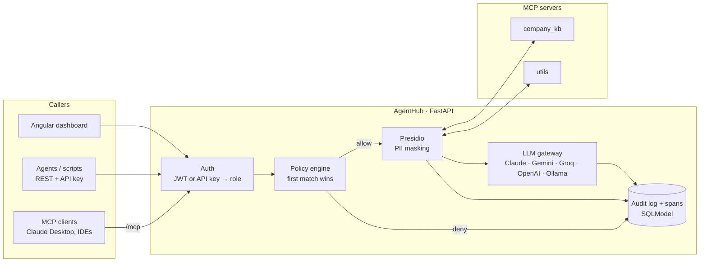

# AgentHub

**An open-source MCP gateway and agent registry.** Register your agents and MCP tool servers in one place, and route every tool call and every LLM call through a single gateway that enforces role-based policies, masks personal data, and records an audit log and a trace.

**Live demo:** https://agent-hub-tawny-three.vercel.app (sign in with `demo` / `demo`, a read-only viewer account that can still run the agent crew)

> When a team ships more than a handful of agents, the same questions come up. Which agents exist? Which tools can they call? Who called what, with which data? AgentHub answers all three from one place.

- **Agent registry.** Agents from any framework (LangGraph, AutoGen, Google ADK, …) are described by A2A-style Agent Cards: owner, version, skills, status. Cards are served at `/agents/{slug}/card` and can be imported from other registries.
- **MCP gateway.** MCP servers (stdio or streamable HTTP) are registered once; their tools are discovered on connect. Every call goes through policy → PII masking → audit → trace, whether it comes from the REST API, the dashboard or an MCP client.
- **One MCP endpoint for every client.** Claude Desktop, VS Code or another agent connects to `/mcp` with an API key and sees only the tools its role may call.
- **Policies.** Ordered, first-match-wins rules on role × server × tool (globs allowed), each with allow/deny and a mask-PII switch. Nothing matches → denied.
- **PII masking with Microsoft Presidio.** Names, emails, phone numbers, card numbers, IBANs, SSNs, IPs, PAN and Aadhaar numbers are replaced (`<PERSON>`, `<EMAIL_ADDRESS>`, …) in tool results and in prompts *before* they reach an LLM provider.
- **LLM gateway.** One endpoint in front of Claude, Gemini, Groq, OpenAI or a local Ollama model, with the same masking, audit and tracing. With no key it runs in a scripted mode, so the demo never breaks.
- **Traces and audit.** Every run produces a span waterfall (agents → tool calls → LLM calls) plus the agent-to-agent hand-offs; every decision lands in a filterable audit log with the reason, PII counts and latency.
- **A working example.** A four-agent LangGraph *Research Crew* (planner → researcher → writer → reviewer) that only ever talks to the gateway, so you can watch governance happen.

## What the demo shows

The demo seeds two MCP servers, six agents and these policies:

| # | Role | Server / tool | Effect | Mask PII | Why |
|---|---|---|---|---|---|
| 10 | admin | `*` / `*` | allow | no | Admins have full, unmasked access |
| 20 | `*` | `company_kb` / `get_contract` | **deny** | – | Contracts are restricted to the legal team |
| 30 | agent | `company_kb` / `*` | allow | yes | Agents may read the knowledge base with PII masked |
| 40 | agent | `utils` / `*` | allow | no | Agents may use utilities |
| 50 | developer | `*` / `*` | allow | yes | Developers may call any tool, PII masked |
| 60 | viewer | `*` / `*` | allow | yes | Viewers may try tools in the console, PII masked |
| – | anything else | | **deny** | | Default |

Things to try:

1. **Servers →** call `company_kb.get_customer` with `acme`. As `demo` the result comes back with 8 values masked; as `admin` the same call is unmasked.
2. **Servers →** call `company_kb.get_contract`. Denied by rule 20 before the tool runs.
3. **Playground →** *Prepare a customer brief for Acme Corp*. Watch the four agents hand off over A2A, call tools through the gateway and produce a brief in which customer contacts appear as `<PERSON>` and `<EMAIL_ADDRESS>`: the data was masked before the model saw it.
4. **Traces →** open the run: a waterfall of agent spans with their tool and LLM calls nested inside.
5. **Audit →** filter by `denied` to find the crew's blocked contract lookup, linked to its trace.
6. **Policies** (as admin) → add `agent · company_kb · list_open_tickets · deny` above rule 30, save, and re-run the crew: the ticket lookup is now denied and the brief changes, without touching agent code.

The public demo resets and reseeds its database every time the server starts.

## How it works



**A tool call, step by step.** The caller authenticates with a JWT (people) or an `ah_…` API key (agents) and gets a role: `admin`, `developer`, `agent` or `viewer`. The policy engine walks the rules in priority order and takes the first whose role, server glob and tool glob match. On *deny*, the tool never runs and the decision is audited. On *allow* with masking on, unambiguous identifiers in the arguments are masked first; the call then goes to the MCP server over the session the gateway keeps open, and the result is masked before it is returned. The audit row records the principal, decision, reason, entity counts and latency; if the call belongs to a run, a span is attached to that run's trace.

**MCP connections.** `McpPool` keeps one client session per registered server, using the official MCP Python SDK. Stdio servers are started as subprocesses; HTTP servers are reached over streamable HTTP. Tools are discovered with `list_tools` on connect, and a server can be reconnected from the dashboard. Registering new stdio servers through the API is disabled by default (`AGENTHUB_ALLOW_STDIO_REGISTRATION`), because it would let an admin account execute commands on the host.

**Aggregated `/mcp` endpoint.** A low-level MCP server, mounted on the same app, lists the tools visible to the caller's role as `server__tool` and forwards each call through the same pipeline as the REST API.

**The Research Crew** (`agents/research_crew/`) is a LangGraph state graph. It holds only a gateway API key with the `agent` role; every tool and model call goes through `/gateway/...`, and every hand-off is posted as an A2A message, so policies, masking and tracing apply to it like to any other client. Inside the server it runs in-process over an ASGI transport; from the command line it runs against any AgentHub URL:

```bash
uv run --project backend python -m agents.research_crew "Prepare a customer brief for Acme Corp" \
    --url http://localhost:8000 --key ah_demo_research_crew_key
```

**PII masking** uses Presidio with spaCy's small English model, including its Indian PAN and Aadhaar recognisers, plus a custom recogniser for international phone numbers. JSON results are walked value by value, and field names such as `email` or `phone` hint the entity type. Person names are masked in results but not in tool arguments, so a search by name still works.

## Use it from Claude Desktop or another MCP client

Create an API key in the dashboard (admin) or use one you've been given, then point any streamable-HTTP MCP client at `/mcp`:

```json
{
  "mcpServers": {
    "agenthub": {
      "type": "http",
      "url": "http://localhost:8000/mcp",
      "headers": { "X-API-Key": "ah_..." }
    }
  }
}
```

The client sees only the tools the key's role may call, and every call shows up in the audit log.

## Run it locally

You need [uv](https://docs.astral.sh/uv/) and Node 22.

```bash
# API on :8000 (seeds the demo data; the MCP servers start automatically)
cd backend
uv sync
uv run uvicorn app.main:app --port 8000

# Dashboard on :4200
cd frontend
npm install
npx ng serve
```

Open http://localhost:4200 and sign in as `admin` / `admin` or `demo` / `demo`. The interactive API docs are at http://localhost:8000/docs.

For LLM-written agent output, copy `backend/.env.example` to `backend/.env` and set one key. `GOOGLE_API_KEY` (Gemini) and `GROQ_API_KEY` both have free tiers. Without a key the LLM gateway answers in scripted mode; everything else is real.

If port 8000 is taken, run the API on another port and point the dashboard at it:

```bash
AGENTHUB_API_URL=http://localhost:8001 node frontend/scripts/write-env.mjs
```

**With Docker:** `docker build -f backend/Dockerfile -t agenthub-api .` from the repo root.

**Tests:**

```bash
cd backend
uv run pytest -q                                  # 43 tests: policy, PII, gateway, MCP pool, /mcp, runs, A2A, tracing
uv run ruff check app tests ../agents ../mcp_servers
```

## Deploy

**API → Render** (free plan). Create a Blueprint from `render.yaml`, or a Docker web service with Dockerfile path `backend/Dockerfile` and the repo root as build context. The blueprint generates the JWT secret, the admin password and the crew's API key. Set `AGENTHUB_CORS_ORIGINS` to your dashboard URL and optionally `GOOGLE_API_KEY` or `GROQ_API_KEY`. The whole API, including Presidio and both MCP subprocesses, uses about 420 MB of RAM.

**Dashboard → Vercel.** Import the repo with **Root Directory** `frontend`; `vercel.json` handles the build. Set `AGENTHUB_API_URL` to the Render URL; the build writes it into `public/env.js`, so the same bundle can point at any backend.

Free Render instances sleep when idle; the first request after a while takes ~30–60 s.

## Configuration

AgentHub settings use the `AGENTHUB_` prefix (see `backend/app/config.py`); LLM keys use their usual names.

| Variable | Default | |
|---|---|---|
| `AGENTHUB_DEMO_MODE` | `true` | Reset and reseed the database on start; adds the `demo` viewer |
| `AGENTHUB_DATABASE_URL` | `sqlite:///./agenthub.db` | Any SQLAlchemy URL |
| `AGENTHUB_JWT_SECRET` | dev value | **Set a long random value in production** |
| `AGENTHUB_ADMIN_USERNAME` / `AGENTHUB_ADMIN_PASSWORD` | `admin` / `admin` | **Change in production** |
| `AGENTHUB_CREW_API_KEY` | demo value | The Research Crew's gateway key (`ah_` is added if missing) |
| `AGENTHUB_CORS_ORIGINS` | `["http://localhost:4200"]` | JSON list |
| `AGENTHUB_ALLOW_STDIO_REGISTRATION` | `false` | Allow registering stdio MCP servers through the API |
| `AGENTHUB_RATE_LIMIT_PER_MINUTE` | `120` | Per principal |
| `AGENTHUB_TOOL_TIMEOUT_SECONDS` | `15` | |
| `ANTHROPIC_API_KEY` / `GOOGLE_API_KEY` / `GROQ_API_KEY` / `OPENAI_API_KEY` | – | First one set wins, in this order |
| `AGENTHUB_LLM_PROVIDER` | auto | `anthropic`, `google`, `groq`, `openai`, `ollama` or `scripted` |
| `AGENTHUB_LLM_MODEL` | per provider | e.g. `claude-haiku-5-5`, `gemini-flash-lite-latest`, `llama-3.3-70b-versatile` |
| `AGENTHUB_LLM_MASK_PII` | `true` | Mask prompts before they reach the provider |

## API

Interactive docs at `/docs`.

| Endpoint | |
|---|---|
| `POST /auth/login`, `GET /auth/me` | Sign in (JWT) |
| `GET/POST /keys`, `DELETE /keys/{id}` | API keys for agents (admin) |
| `GET/POST /agents`, `GET/PUT/DELETE /agents/{slug}`, `GET /agents/{slug}/card`, `POST /agents/import-card` | Agent registry |
| `GET/POST /servers`, `GET/DELETE /servers/{slug}`, `POST /servers/{slug}/refresh` | MCP servers |
| `GET /policies`, `PUT /policies` | Read / replace the rule list (admin) |
| `GET /gateway/tools`, `POST /gateway/tools/{server}/{tool}` | Tools visible to you; call one |
| `GET /gateway/llm/provider`, `POST /gateway/llm/chat` | LLM gateway |
| `POST /a2a/{slug}/tasks`, `GET /a2a/messages` | Agent-to-agent hand-offs |
| `POST /runs`, `GET /runs/{id}/events` | Start the Research Crew; stream its events (SSE) |
| `GET /runs`, `GET /runs/{id}`, `POST /traces/spans` | Traces |
| `GET /audit`, `GET /stats` | Audit log (filters, `before_id` paging) and dashboard stats |
| `/mcp` | Aggregated MCP endpoint (streamable HTTP) |

Roles: `admin` can do everything; `developer` can edit agents and servers; `agent` is for API keys; `viewer` is read-only (and may try tools, masked).

## Project layout

```
backend/        FastAPI app (uv, Python 3.12)
  app/auth/         JWT + API keys, roles
  app/registry/     agents, MCP servers, policies
  app/gateway/      policy engine, PII masking, MCP pool, tool proxy, LLM gateway, /mcp, rate limits
  app/a2a/          agent-to-agent messages
  app/runs/         Research Crew runs + SSE
  app/tracing/      spans and run traces
  app/observability/  audit log and stats
mcp_servers/    company_kb and utils (MCP SDK `MCPServer`, stdio)
agents/         research_crew (LangGraph)
frontend/       Angular 22 dashboard (standalone, zoneless, signals, Tailwind v4)
```

## Stack

Python 3.12 · FastAPI · MCP Python SDK · LangGraph · Microsoft Presidio + spaCy · SQLModel · PyJWT / bcrypt · Anthropic and OpenAI SDKs · Angular 22 · Tailwind CSS v4 · Docker · GitHub Actions · Render + Vercel

## License

MIT © 2026 Himanshu Chelani
